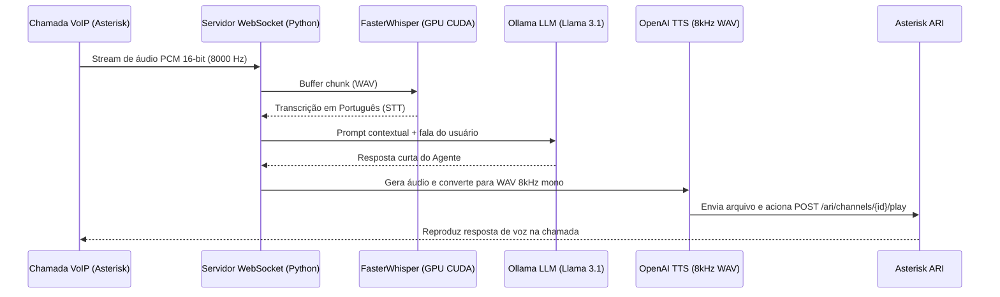

# Transcribe Asterisk — Voice AI & Transcrição em Tempo Real para Asterisk PBX

Pipeline de **IA de Voz em Tempo Real** integrado ao **Asterisk PBX**. Recebe streaming de áudio PCM 16-bit (8 kHz) de chamadas telefônicas via **WebSocket**, realiza transcrição acelerada por GPU com **FasterWhisper (`large-v3`)**, processa o atendimento com LLM local via **Ollama (`llama3.1`)**, sintetiza a resposta em voz (**TTS**) e reproduz o áudio diretamente no canal ativo do Asterisk via **ARI (Asterisk REST Interface)**.

---

## Fluxo de Arquitetura



---

## Componentes do Repositório

| Arquivo | Descrição |
|---------|-----------|
| `transcribe.py` | Servidor WebSocket (`ws://0.0.0.0:8765`) que recebe o stream de áudio do Asterisk, transcreve com `FasterWhisper` (CUDA `float16`), consulta o LLM no Ollama, gera o áudio de resposta (8 kHz mono PCM) e reproduz no canal via Asterisk ARI. |
| `trans_local.py` | Utilitário CLI de alta performance para transcrição de arquivos de gravação (`.mp3` / `.wav`), com detecção automática de GPU NVIDIA (RTX 3070/3080/3090/4090), ajuste dinâmico de *workers*, filtro VAD (*Voice Activity Detection*) e cálculo de *Real-Time Factor (RTF)*. |
| `tts.py` | Script isolado para geração de áudio TTS e conversão automática para o padrão telefônico do Asterisk (`8000 Hz`, `mono`, `16-bit PCM WAV`). |

---

## Tecnologias Utilizadas

- **Python 3.10+**
- **STT (Speech-to-Text)**: `faster-whisper` (`large-v3`, `float16` em GPU CUDA + filtro VAD)
- **LLM Local**: `Ollama` (`llama3.1`)
- **TTS (Text-to-Speech)**: OpenAI Audio Speech (`gpt-4o-mini-tts`) + `pydub` / `soundfile`
- **Telefonia / VoIP**: Asterisk PBX (**ARI** - Asterisk REST Interface & WebSockets)

---

## Como Executar

### 1. Transcrição e Atendimento em Tempo Real (WebSocket + Asterisk)
```bash
python3 transcribe.py
```

### 2. Transcrição de Gravações em Lote / Arquivo Local (com métricas RTF)
```bash
python3 trans_local.py large-v3 gravacao_chamada.mp3
```
